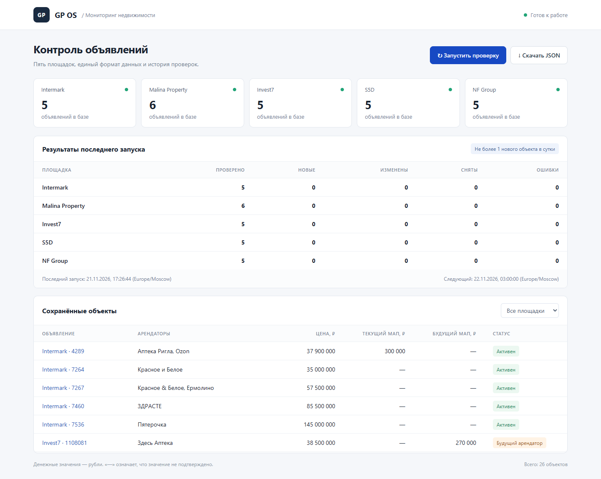

# GP OS — сбор и мониторинг карточек недвижимости

Сервис сбора и ежедневного обновления объявлений с Intermark, Malina Property, Invest7, S5D и NF Group для импорта в GP OS. Объединяет данные пяти площадок в один JSON и показывает результаты проверок в веб-интерфейсе.

Текущий и будущий арендный доход учитываются отдельно. Для нескольких арендаторов сохраняются индивидуальные условия, ступени ставок, индексация и формулы от оборота. Цены и арендные условия сопровождаются фрагментами первоисточника, а расхождения фиксируются в выгрузке.

Проверено на 25 реальных карточках: **63 автоматических теста**, запуск в Docker и два последовательных обращения к сайтам без ошибок. Первый запуск добавил одну карточку, повторный сохранил 26 записей без дублей. Отчёты и скриншоты включены в репозиторий.

## Что входит в решение

- `samples/html/` — 25 исходных HTML-карточек, по пять на площадку.
- `samples/gp_os.json` — единая исходная выгрузка из этих карточек, UTF-8.
- `samples/selection.json` — ссылки, время получения HTML, запрошенный тип объекта и пояснение замены.
- `samples/urls/` — готовые списки URL для пяти отдельных скриптов.
- `scripts/` — пять точек входа; общие правила извлечения находятся в `gp_os/parsers/`.
- `docs/schema.json` — JSON Schema выгрузки.
- `reports/live-run-1.json`, `reports/live-run-2.json` — отчёты двух реальных проверок.
- Веб-интерфейс с ручным запуском, статистикой пяти площадок и скачиванием JSON.

## Запуск в Docker

Нужны Docker Engine и Docker Compose v2. Из каталога проекта:

```bash
docker compose up --build -d
docker compose logs -f collector
```

Откройте <http://localhost:8001>. При первом старте база заполняется 25 карточками из `samples/gp_os.json`. Нажмите **«Запустить проверку»**, чтобы получить актуальные данные с сайтов. Последующие проверки выполняются ежедневно по расписанию. Для скачивания текущей выгрузки нажмите **«Скачать JSON»**.

Состояние, история запусков и суточный лимит сохраняются в Docker volume `collector_data`. Перезапуск контейнера их не сбрасывает. `docker compose down` останавливает сервис; `docker compose down -v` также удаляет его данные и историю.

## Запуск без Docker

Нужен Python 3.12+. Для PowerShell:

```powershell
python -m venv .venv
.venv\Scripts\Activate.ps1
python -m pip install -r requirements.txt
python -m pip install -e '.[dev]'
python -m gp_os serve
```

В Linux/macOS виртуальное окружение активируется командой `source .venv/bin/activate`. Адрес интерфейса тот же: <http://localhost:8001>.

Один полный проход без веб-сервера:

```bash
python -m gp_os collect --report reports/check.json
```

Он перепроверяет сохранённые карточки и каталоги всех пяти площадок, обновляет `data/gp_os.json` и сохраняет отчёт. Для независимой проверки можно задать другую директорию через `--data-dir`, но её суточный лимит будет отдельным: он действует на одну общую базу состояния.

## Пять отдельных скриптов

Каждый принимает URL позиционными аргументами или JSON-массивом из файла. Виртуальное окружение должно быть активировано, проект — установлен командой `pip install -e .`.

```bash
python scripts/intermark.py --input samples/urls/intermark.json --output data/intermark.json
python scripts/malina.py --input samples/urls/malina.json --output data/malina.json
python scripts/invest7.py --input samples/urls/invest7.json --output data/invest7.json
python scripts/s5d.py --input samples/urls/s5d.json --output data/s5d.json
python scripts/nfgroup.py --input samples/urls/nfgroup.json --output data/nfgroup.json
```

Можно передать новые ссылки без изменения кода:

```bash
python scripts/invest7.py https://invest7.ru/lots/868109 https://invest7.ru/lots/1119719 --output data/invest7.json
```

По умолчанию HTML скачивается в `samples/html/<площадка>/<id>.html`. Чтобы сохранять новые снимки отдельно от исходной выборки, задайте `--html-dir data/manual-html`.

Флаг `--offline` позволяет воспроизвести разбор сохранённых HTML без сети:

```bash
python scripts/intermark.py --input samples/urls/intermark.json --offline --output data/intermark-offline.json
python scripts/build_samples.py
```

Последняя команда пересобирает единый `samples/gp_os.json` из 25 архивных HTML и `samples/selection.json`. Пять ручных парсеров предназначены для разового извлечения; ежедневный лимит и историю ведут команда `collect` и веб-интерфейс.

## Формат для импорта

Корень выгрузки — объект, ключ каждой записи — `<source>:<listing_id>`, например `intermark:4289`. Арендаторы представлены массивом `tenants`. Неизвестные значения — `null`; пустой список означает отсутствие подтверждённых элементов.

Денежные значения и площадь сериализуются десятичными строками, чтобы не терять точность при передаче в другую систему. Все денежные поля — рубли, месячные платежи — рубли за месяц, площадь — квадратные метры. Валютной конвертации нет. Полные даты имеют формат ISO `YYYY-MM-DD`, время — ISO 8601 в UTC.

| Поле | Смысл |
| --- | --- |
| `source`, `listing_id`, `url` | Площадка, её ID и канонический URL без рекламных параметров |
| `collected_at` | Когда запись впервые получена |
| `last_successful_check_at` | Последняя успешная проверка; сетевой сбой не обновляет это поле |
| `status` | `active` или `removed` |
| `title`, `description` | Заголовок и полное описание карточки, без меню, похожих объектов и рекламного футера |
| `price_rub`, `area_m2` | Цена продажи и площадь |
| `address`, `map_url` | Адрес и ссылка на поиск этого адреса на карте |
| `map_url_generated` | `true`: ссылка на карту построена по адресу из объявления |
| `metro`, `vat`, `commission`, `owner` | Сведения из источника, если извлечены; налоговые обозначения сохраняются текстом без самостоятельного вывода об освобождении от НДС |
| `ownership_form` | Указанная в источнике форма владения, отдельно от имени собственника |
| `photos` | Ссылки на фотографии объекта; сами изображения не скачиваются |
| `rent_current_rub`, `rent_future_rub` | Общий текущий и заявленный будущий МАП, отдельно |
| `payback_years` | Простая окупаемость в годах: `price_rub / (12 × rent_current_rub)` |
| `tenants` | Имена и условия каждого подтверждённого арендатора |
| `evidence` | Фрагменты источника и место извлечения цены/арендных условий |
| `discrepancies` | Противоречащие значения и объяснение выбранного приоритета |
| `warnings` | Недостаточные или неоднозначные данные |
| `requested_category`, `replacement_note` | Тип из задания и пояснение замены, если она потребовалась |
| `html_file`, `html_sha256` | Путь к снимку и SHA-256 его UTF-8-текста с нормализованными переводами строк |

Для арендатора сохраняются `name`, `status` (`current`, `future`, `unknown`), `lease_start`, `lease_end`, исходный срок `lease_term_raw`, индексация `indexation_raw`, текущий/будущий МАП, `rate_start`/`rate_start_raw`, массив `rent_steps`, формула от оборота `turnover_formula_raw` и фрагмент `source_excerpt`.

У ступени есть `amount_rub`, `from_date`, `from_month`, `to_month` и `raw`. Номер месяца отсчитывается от начала аренды и начинается с 1. Частичные даты сохраняются в исходной формулировке; ISO-дата заполняется только при наличии полного дня, месяца и года.

Окупаемость не рассчитывается по будущему доходу, при неизвестной цене или нулевом/неизвестном текущем МАП. Расчёт простой: без индексации, налогов, расходов и прогноза оборота. Если ставка содержит процент от оборота, сохраняется исходная формула; известная фиксированная часть не превращается в прогноз фактической выручки.

## Правила по площадкам

| Площадка | Основные источники полей |
| --- | --- |
| Intermark | Блок `.object-detail`, основной заголовок и цена `.price-text1`; JSON-LD Product используется для фотографий, а не для адреса агентства |
| Malina Property | `.b--item-head`, описание карточки и именованные строки условий; повторная мобильная версия описания не дублируется |
| Invest7 | Заголовок, блок цены без цены за м², описание и таблица арендаторов; фотографии берутся из галереи объекта |
| S5D | `.article-top-section`, `.price-article`, технические и коммерческие параметры; аренда вместо продажи исключается |
| NF Group | `.detail-view`, характеристики, адрес, описание и RUB-цена; цена за м² и цены других валют не склеиваются с ценой продажи; распознаётся явное снятие публикации |

При расхождении цены шапки и описания приоритет у шапки, оба значения сохраняются. Если виджет округлил площадь, а описание содержит близкое дробное значение, сохраняется более точная площадь и отметка о расхождении. Если сайт дал только общий МАП нескольких арендаторов, платежи между ними не распределяются. Предварительный договор и явно будущее начало аренды не считаются действующим доходом.

### Замена в исходной выборке

Для Intermark использована предусмотренная заданием замена: действующая кофейня «Здрасте», ID `7460`, с опубликованными сроком договора и индексацией. В просмотренных объявлениях продажи и поисковой выдаче карточка с подтверждённым будущим арендатором отсутствовала. Основание замены сохранено в `selection.json` и самой записи; статус арендатора — `current`, неопубликованный МАП — `null`. Остальные площадки представлены всеми пятью запрошенными типами.

## Ежедневное обновление и защита от дублей

По умолчанию встроенное расписание запускает проверку в **03:00 Europe/Moscow**. Переменные окружения:

| Переменная | По умолчанию |
| --- | --- |
| `GP_OS_RUN_AT` | `03:00` |
| `GP_OS_TIMEZONE` | `Europe/Moscow` |
| `GP_OS_SCHEDULE_ENABLED` | `true` |
| `GP_OS_DATA_DIR` | `data` |
| `GP_OS_SOURCES` | `sources.json` |

В Docker эти значения задаются в `docker-compose.yml`. `sources.json` позволяет менять страницы каталогов без правки Python. Работающий процесс должен оставаться запущенным; пропущенный во время остановки запуск не восстанавливается автоматически.

Проверяются все сохранённые карточки и каталоги всех пяти площадок. В качестве новых подходят карточки продажи с подтверждённым арендатором. Для ограничения нагрузки подробно просматриваются не более восьми новых кандидатов на площадку за запуск; непроверенные кандидаты могут быть рассмотрены в следующем запуске.

Перед добавлением сверяются `source + ID`, нормализованный URL и точное совпадение нормализованного адреса, площади и набора арендаторов. Это консервативная проверка явных совпадений; разные помещения в одном доме не объединяются по одному адресу. Межплощадочные расхождения площади или разные написания неизвестных организаций могут потребовать ручной сверки.

Суточный лимит — **одна новая запись суммарно**, по календарному дню настроенного часового пояса. Лимит фиксируется транзакцией SQLite и переживает перезапуск. Повторный ручной запуск в тот же день продолжает обновлять существующие записи, но не получает ещё одну квоту. При отсутствии подходящих новых карточек в отчёте будет ноль.

HTTP 410 или явное сообщение о снятии подтверждают удаление. Первый HTTP 404 только увеличивает счётчик и показывает предупреждение; снятие подтверждается при повторной проверке. Исчезновение ссылки из каталога само по себе не считается снятием. При 403, 429, 5xx, таймауте или ошибке разбора последние значения сохраняются, а ошибка попадает в отчёт.

Проверка защищена общей блокировкой SQLite от одновременного ручного, CLI- и планового запуска. После аварийного завершения блокировка истекает через 15 минут. SQLite хранит состояние и историю, а JSON экспортируется атомарно. Такое решение сохраняет транзакционность суточного лимита и позволяет развернуть приложение одним контейнером.

Если используется внешний планировщик Windows или cron, установите `GP_OS_SCHEDULE_ENABLED=false` и запускайте `python -m gp_os collect` один раз в сутки из каталога проекта. Час запуска задаётся в выбранном планировщике. Встроенное расписание рассчитано на один серверный процесс.

## Проверка

```bash
python -m pytest -q
python -m ruff check gp_os scripts tests
python -m ruff format --check gp_os scripts tests
```

Финальная проверка: 63 теста проходят локально в Windows и внутри Docker с Python 3.12; Ruff и проверка форматирования проходят без ошибок.

Тесты используют сохранённые реальные HTML и изолированные HTTP-ответы. Проверяются все 25 карточек, денежные форматы, несколько арендаторов, будущая аренда, ступени и процент от оборота, снятие, сохранение данных при сбое, ограничения URL/редиректов, суточная квота при конкуренции, повторный запуск и скачивание JSON. Изменение цены специально моделируется в тесте `test_two_runs_update_add_one_and_do_not_duplicate`.

Реальные прогоны сохранены в `reports/live-run-1.json` и `reports/live-run-2.json`. Они фиксируют состояние сайтов на момент проверки; неизменившаяся цена не считается изменением только потому, что обновилось время проверки.

Первый прогон добавил одну новую карточку, повторный не добавил ни одной: осталось 26 записей. За интервал двух проверок цены и условия не изменились, ошибок сайтов не было.

Скриншоты этих запусков из Docker-интерфейса:




Изменение цены можно воспроизвести без сети:

```bash
python scripts/replay_demo.py
```

Сценарий использует реальные сохранённые HTML, но в памяти подменяет одну цену для проверки ветки обновления. Он получает одну изменённую и одну новую запись, затем повторяет проверку без изменений и дублей. Результат — `reports/replay.json`, с явной отметкой о моделировании. Исходная выгрузка и рабочая база не изменяются.

## Применение ИИ

ИИ использовался как вспомогательный инструмент при подготовке кода, тестов и документации. Извлечение данных выполняется HTML-парсерами по явным правилам, без обращения к языковым моделям. Проверка опирается на сохранённые HTML, автоматические тесты и реальные прогоны.
